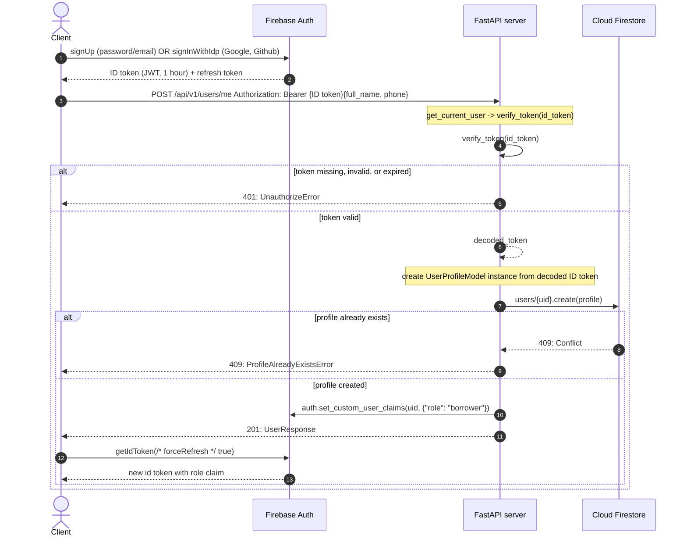
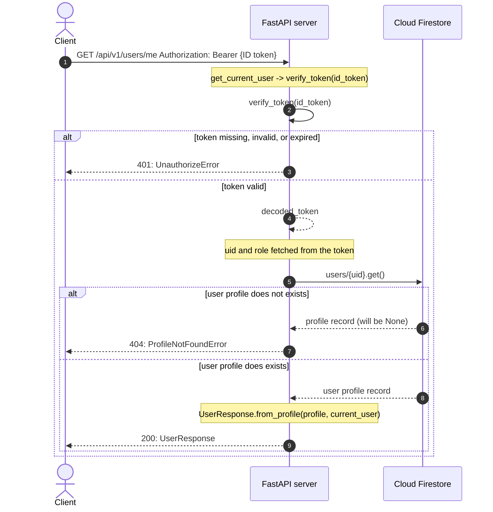

# Authentification and Authorization

This document describes how auth and authz takes place in Agentic Lender from AL-Core perspective.

Before describing whole architecture it’s important to notice that AL-Core **does not** handle sign-in/up process directly, instead Firebase is used, i.e.: **Firebase Auth** (as an "identity provider") for user accounts AND **Cloud Firestore** for user profile records (contains any other data that will be relevant to the user, used in queries, or relates in other collections).

## Components

Authentification and authorization in our case includes next 4 types of components: **Client**, **Identity Provider**, **API** (i.e., resource server), **Persistance Storage** (i.e. database).

| Type | Component | Interacts With | Owns | Responsibility |
|:---:|:---:|:---:|:---:|:---|
| Client| React, Android | Firebase Auth, REST API | ID and refresh token | UI; sign-in/up through Firebase client SDK; sending JWT token with each request; refreshing token after role changes |
| Identity Provider | Firebase Auth | Client, REST API | user accounts | managing user accounts, including custom claims and tokens |
| API | FastAPI server | Client, Firebase Auth, Cloud Firestore | - | allows access to Firestore through defined contracts (routes and schemas), verifies JWT and ensures RBAC |
| Persistance Storage (database) | Cloud Firestore | REST API | user profiles and other application related data | managing user profiles; not accessible directly for clients |

> [!NOTE]
> Firebase Auth is built on [OAuth 2.0](https://auth0.com/intro-to-iam/what-is-oauth-2) and [OpenID Connect (OIDC)](https://openid.net/developers/how-connect-works/).

## Step-by-step workflow

Simplified sequence diagrams of avaliable auth routes represented below. End-user not is captured by sequence diagrams below but it's worth to remember that he/she communicates with client app.

### `POST /api/v1/users/me`

### `GET /api/v1/users/me`

> [!WARNING]
> During verify_token(id_token), if argument `check_revoked: bool = False` is not set to True, then
> ID token verified locally, so there is no request to Firebase Auth. Sequence diagrams above does not consider case with `check_revoked = True`.

### Common steps

**Client** part:

1. **Sign up/in**. End-user using client (React or Android app) creates account through Firebase Client SDK.

2. **Token creation**. Firebase Auth returns signed ID (valid for one hour) and refresh token to the client.

3. **API Request**. Client sends `POST` / `GET` request to the REST API server `/api/v1/users/me` including ID token in the header: `Authorization: Bearer <ID token>`.

**Server** part:

4. **Token verification**. REST API verifies clients JWT using Firebase Admin SDK, decodes it, and extract required data (using `get_current_user` and `verify_token` dependencies). An invalid or expired token is rejected with `HTTP_401_UNAUTHORIZED`.

**`POST /me`**

5. **Profile creation and role assignment*** (ONLY if not existed before). REST API server creates user profile document inside `users` collection (`users/{uid}`) and **returns UserResponse**.

**`GET /me`**

5. **Profile search**. REST API server reads `users/{uid}` using `uid` from the decoded ID token. If the profile has not been found (not created yet) `HTTP_404_NOT_FOUND` returned, otherwise **UserResponse**.

> [!IMPORTANT]
> After `POST /me` client calls `getIdToken(true)` to get ID token WITH custom claims (i.e., role) assigned. For all **subsequent requests** ID token included in the `Authorization` header.
