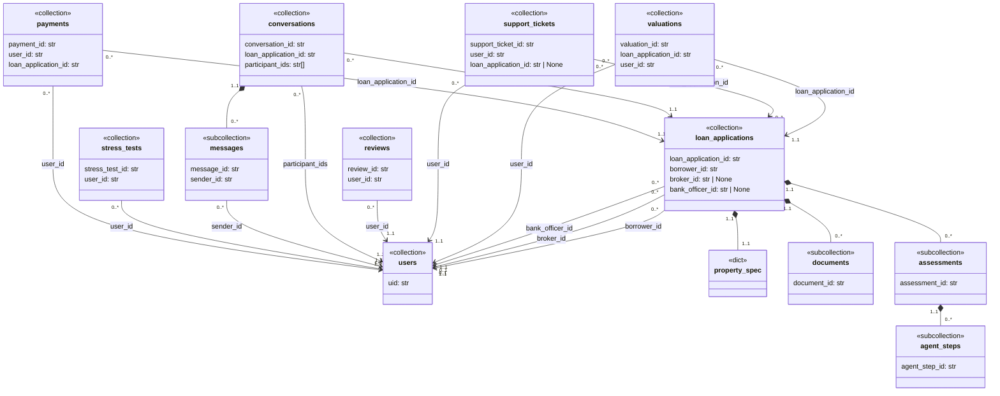
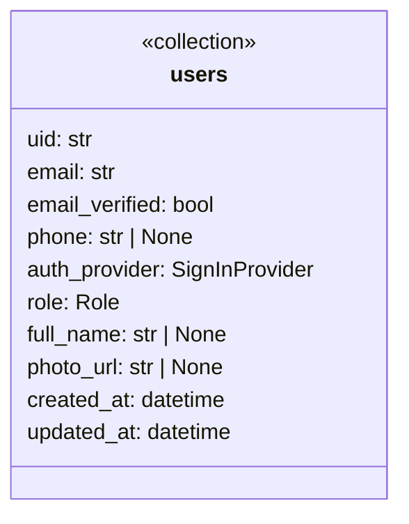

# Data model design

This document describes **data model** used, i.e.: **which** data is saved on the database by Agentic Lender, **how** it is structured, and **why** it designed in such way.

> [!TIP]
> This file is used as a reference for all API contracts (generated `openapi.yaml`). You can get familiar with Pydantic
> schemas (`./schemas`), models (`/models`) and routes (`./router`) inside of the API source code if you want more details.

- [Data model design](#data-model-design)
  - [Initial reasoning and conventions](#initial-reasoning-and-conventions)
    - [Ground rules](#ground-rules)
    - [How to read the field tables](#how-to-read-the-field-tables)
  - [Structure of collections](#structure-of-collections)
  - [Each collection in details](#each-collection-in-details)
    - [users](#users)
    - [valuations](#valuations)
    - [loan\_applications](#loan_applications)
      - [property\_spec](#property_spec)
      - [documents](#documents)
      - [assessments](#assessments)
      - [agent\_steps](#agent_steps)
    - [support\_tickets](#support_tickets)
    - [reviews](#reviews)
    - [conversations](#conversations)
      - [messages](#messages)
    - [stress\_tests](#stress_tests)
    - [payments](#payments)

## Initial reasoning and conventions

BaaS (Backend as a Service), i.e. Firebase platform, is used for the backend of this project. It offers NoSQL (aggregate-oriented) database management, authentication and authorization, and usage analytics features, which make the development process considerably easier.

In the context of the data model (that is, database design) Firebase provides Cloud Firestore and/or Realtime database, both of them are NoSQL document-oriented database (consisting of collections and documents), which are highly scalable and schemaless.

Consequently, what has been said above means that an aggregate data model needs to be developed.

### Ground rules

There are following rules, which are strictly adhered:

- **read / write access**: Only the AL-Core subsystem has write access (through Firebase Admin SDK) to the database; all others (web and mobile clients, AI engine) have read-only access (through Firebase Client SDK), described by Firestore security rules (`.\api\src\firebase\firestore.rules`). However, it is assumed that they will use the AL-Core API for both reading and writing, rather than accessing the database directly.

- **data sources**:
  - **Firebase Auth** -> end-users credentials, custom claims (role, sign-in provider).
  - **Etherum blockchain** -> minted loan notes and audit hashes; Firestore keeps pointers to them (transaction hash, token ID).
  - **Stripe / PayPal sandbox** -> payment state; Firestore mirrors it from webhooks
  - **Cloud Firestore** -> all other data relevant to the users.  

- **naming**: Collections and fields are named with plural in snake_case.

- **documents IDs**: For `users` Firebase Auth uid is used, Firestore auto ID for every other collection.

### How to read the field tables

Each collection described with a separate row for each field containing following columns:
field, type, req, source, description.

**field**: Firestore document field name (must be snake_case).

**type**: type of the field value used in Pydantic schemas and Firestore.

| type                          | meaning                                | in Pydantic           | in Firestore                     |
|-------------------------------|----------------------------------------|-----------------------|----------------------------------|
| str, int, float, bool         | primitive values                       | built-in types        | string, integer, double, boolean |
| datetime                      | UTC timestamp (i.e., since epoch)      | datetime              | timestamp                        |
| T[]                           | list of elements with same type        | list[T]               | array                            |
| dict                          | associative array (i.e., hash table)   | nested Pydantic model | map                              |
| PascalCase name               | enumeration                            | Enum or StrEnum       | integer/float or string          |

**req**: if the value is present or None / null.

| req | meaning                                         |
|-----|-------------------------------------------------|
| x   | required: always present, never null            |
| ?   | nullable: always present, null until known      |
| -   | optional: the field may be absent               |

**source**: who produces the value (AL-Core always performs the write).

| source | meaning                                                           |
|--------|-------------------------------------------------------------------|
| auth   | taken from the claims of verified Firebase ID token               |
| client | entered by the end user (through AL-Mobile or AL-Web)             |
| core   | generated by REST API (i.e, AL-Core)                              |
| ai     | produced by multi-agent comittet and ML model (i.e. AL-AI Engine) |
| bchain | taken from a blockchain transaction receipt                       |
| psp    | taken from the Stripe / PayPal webhook                            |

## Structure of collections

```text
users/{uid}

valuations/{valuation_id}

loan_applications/{loan_application_id}
|
|- property_spec (dictionary, not subcollection)
|
|- documents/{document_id}
|
|- assessments/{assessment_id}
     |
     |- agent_steps/{agent_step_id}

support_tickets/{support_ticket_id}

reviews/{review_id}

conversations/{conversation_id}
|
|- messages/{message_id}

stress_tests/{stress_test_id}

payments/{payment_id}
```

<div align="center"><b>ERD (Entity Relationship Diagram)</b> will appear as follows:</div>

<span></span>




## Each collection in details

### users

One profile per Firebase Auth account (made using Firebase Client SDK); created by `POST /api/v1/users/me` request after
first sign-in.

| field          | type           | req   | source    | description                                                                                      |
|----------------|----------------|-------|-----------|--------------------------------------------------------------------------------------------------|
| uid            | str            | x     | auth      | Firebase Auth uid; must be a string between 1-128 characters long inclusive                      |
| email          | str            | x     | auth      | The user's primary email; must be a valid email address                                          |
| email_verified | bool           | x     | auth      | Whether or not the user's primary email is verified; the default value is False                  |
| phone          | str            | -     | client    | The user's primary phone number; must be a valid E.164 spec compliant phone number               |
| auth_provider  | SignInProvider | x     | auth      | The user's authentication provider (i.e., email_password, Google, GitHub)                        |
| role           | Role           | x     | core      | The user's role (i.e., retail_borrower, mortgage_broker, underwriting_bank_officer)              |
| full_name      | str            | ?     | auth      | The user's full name                                                                             |
| photo_url      | str            | -     | auth      | The user's photo URL (i.e., profile avatar image)                                                |
| created_at     | datetime       | x     | core      | Account creation time stamp                                                                      |
| updated_at     | datetime       | x     | core      | Account details modification time stamp                                                          |



### valuations

...

### loan_applications

...

#### property_spec

...

#### documents

...

#### assessments

...

#### agent_steps

...

### support_tickets

...

### reviews

...

### conversations

...

#### messages

...

### stress_tests

...

### payments

...
