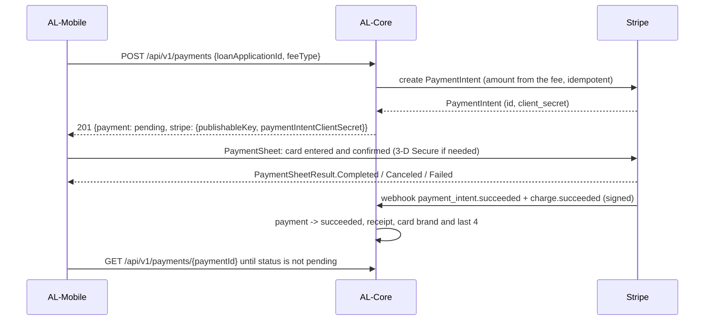

# Payments (AL-Core + AL-Mobile, Stripe)

**Jira:** ALG4-52 (epic), ALG4-150 (contract and mocks), ALG4-101 (sandbox) · **Author:** Pavlo · **Status:** contract and sandbox ready; endpoints in ALG4-227, ALG4-228, ALG4-232

A retail borrower pays a fee for their loan application from the mobile app: the **application verification fee**
(€49) or the **fast-track appraisal** (€149, ALG4-103). Payments go through **Stripe** in **test mode** (a sandbox),
so no real money moves. The card is typed into Stripe's own payment sheet on the phone: card details never reach
AL-Core or Firestore.

## How a payment works



1. The app asks AL-Core to start paying a fee. AL-Core decides the amount (the app never sends one), saves a
   `pending` payment and creates a Stripe PaymentIntent for it.
2. The app opens Stripe's **PaymentSheet** with the client secret. Stripe handles the card, 3-D Secure and errors.
3. Stripe tells AL-Core the outcome through a **signed webhook**; only the webhook changes a payment's status.
4. The app polls the payment until it is no longer `pending` (usually a second or two after the sheet closes) and
   shows the result; the payment history lists every payment.

## Contract

All bodies are JSON in camelCase. Every endpoint except the webhook needs `Authorization: Bearer <Firebase ID token>`
of a **retail borrower**. Schemas in code: `api/src/payments/v1/schemas.py`; the data stored: [data-model.md, payments](data-model.md#payments).

| method | path                                | who      | answer                                                   | task     |
|--------|-------------------------------------|----------|----------------------------------------------------------|----------|
| POST   | `/api/v1/payments`                  | borrower | `PaymentCheckoutResponse` (201, or 200 when reused)      | ALG4-227 |
| GET    | `/api/v1/payments`                  | borrower | `PaginatedResponse[PaymentResponse]`, newest first       | ALG4-232 |
| GET    | `/api/v1/payments/{paymentId}`      | borrower | `PaymentResponse`                                        | ALG4-232 |
| POST   | `/api/v1/payments/webhooks/stripe`  | Stripe   | `{"received": true}`                                     | ALG4-228 |

### Fees

| `feeType`                  | what                                                    | amount |
|----------------------------|---------------------------------------------------------|--------|
| `application_verification` | one-off check of income, debts and deposit              | €49    |
| `appraisal_processing`     | fast-track: priority property appraisal (ALG4-103)      | €149   |

Amounts live in `api/src/payments/fees.py` (in cents, as Stripe expects); the same values are in the mobile app.

### POST /api/v1/payments: start paying a fee

```json
{"loanApplicationId": "demo-app-0001", "feeType": "appraisal_processing"}
```

**201 Created** ([mock](mocks/payments/create-payment.response.json)):

```json
{
  "payment": {"paymentId": "demo-payment-0001", "loanApplicationId": "demo-app-0001", "feeType": "appraisal_processing",
              "amount": 149.0, "currency": "eur", "provider": "stripe", "status": "pending", "receiptUrl": null,
              "failureReason": null, "cardBrand": null, "cardLast4": null,
              "createdAt": "2026-11-24T10:00:00Z", "paidAt": null},
  "stripe": {"publishableKey": "pk_test_...", "paymentIntentClientSecret": "pi_..._secret_...",
             "merchantDisplayName": "Agentic Lender"}
}
```

| status | when                                                                                                     |
|--------|----------------------------------------------------------------------------------------------------------|
| 200    | a `pending` or `failed` payment of this fee already exists for the application: it is returned with its PaymentIntent, so a retry never creates a second charge |
| 404    | the application does not exist or is not the borrower's                                                  |
| 409    | this fee is already paid ([mock](mocks/payments/error-already-paid.response.json)), or the application is `Closed` |
| 422    | unknown `feeType`                                                                                        |
| 502    | Stripe rejected the request                                                                              |
| 503    | payments are not configured on this server (no Stripe keys)                                              |

The PaymentIntent is created with the payment ID as idempotency key and in its metadata (`payment_id`,
`loan_application_id`, `fee_type`, `user_id`), so the Stripe Dashboard shows which payment and application it belongs to.

### GET /api/v1/payments and GET /api/v1/payments/{paymentId}

`PaymentResponse` ([succeeded](mocks/payments/payment-succeeded.response.json), [failed](mocks/payments/payment-failed.response.json),
[history](mocks/payments/payments-history.response.json)). The list takes `page`, `pageSize` and an optional
`loanApplicationId`. A payment of another user answers 404. The Stripe PaymentIntent ID is never returned.

| `status`    | meaning                                                                     |
|-------------|-----------------------------------------------------------------------------|
| `pending`   | created, not paid yet (or the webhook has not arrived yet)                  |
| `succeeded` | paid; `receiptUrl`, `cardBrand`, `cardLast4`, `paidAt` are set              |
| `failed`    | the last attempt failed (`failureReason`); paying again reuses the payment  |
| `refunded`  | refunded in full from the Stripe Dashboard                                  |

### POST /api/v1/payments/webhooks/stripe

Called by Stripe only. No bearer token: the request is accepted only with a valid `Stripe-Signature` header (signed
with `STRIPE_WEBHOOK_SECRET`, at most 5 minutes old), otherwise **400**. Events and what they change
(`api/src/payments/webhooks.py`; [sample events](mocks/payments/)):

| event                           | change on the payment (matched by PaymentIntent ID)        |
|---------------------------------|------------------------------------------------------------|
| `payment_intent.succeeded`      | `status` = `succeeded`, `paidAt`                           |
| `charge.succeeded`              | `receiptUrl`, `cardBrand`, `cardLast4`                     |
| `payment_intent.payment_failed` | `status` = `failed`, `failureReason`                       |
| `payment_intent.canceled`       | `status` = `failed`                                        |
| `charge.refunded` (in full)     | `status` = `refunded`                                      |

Any other event, or an event for an unknown PaymentIntent, is acknowledged with 200 and ignored, so Stripe does not
retry it.

## Set up the sandbox (ALG4-101)

Each developer uses their own free Stripe sandbox; keys are personal and never committed.

1. **Account**: sign up at [dashboard.stripe.com](https://dashboard.stripe.com) and stay in a sandbox / test mode
   (no business details are needed for test mode).
2. **Keys**: *Developers → API keys*: copy the **Publishable key** (`pk_test_...`) and the **Secret key**
   (`sk_test_...`) into `.env` in the repo root (Docker Compose) or `api/.env` (AL-Core on its own):
   ```dotenv
   STRIPE_SECRET_KEY=sk_test_...
   STRIPE_PUBLISHABLE_KEY=pk_test_...
   ```
   Outside `RUN_MODE=prod` AL-Core refuses live keys (`sk_live_...`), so the sandbox cannot charge a real card.
3. **Webhooks on your machine** (needed once the webhook endpoint, ALG4-228, exists): install the
   [Stripe CLI](https://docs.stripe.com/stripe-cli). Windows: download `stripe_<version>_windows_x86_64.zip` from
   [its releases](https://github.com/stripe/stripe-cli/releases), unzip it anywhere and run `.\stripe.exe` from that
   folder (or with Scoop: `scoop bucket add stripe https://github.com/stripe/scoop-stripe-cli.git`, then
   `scoop install stripe`). Then:
   ```bash
   stripe login
   stripe listen --forward-to localhost:8000/api/v1/payments/webhooks/stripe \
     --events payment_intent.succeeded,payment_intent.payment_failed,payment_intent.canceled,charge.succeeded,charge.refunded
   ```
   It prints a signing secret `whsec_...`: put it in `STRIPE_WEBHOOK_SECRET` and restart AL-Core. Keep `stripe listen`
   running while you test payments.
4. **Check it**. It checks the keys and makes two €1 test payments (one succeeds, one is declined); both appear in
   the Dashboard and in `stripe listen`.
   - Docker Compose (keys in the root `.env`): rebuild AL-Core so it has the new code, then run the check inside it:
     ```bash
     docker compose up -d --build api
     docker compose exec api python -m src.scripts.stripe_sandbox_check
     ```
   - AL-Core without Docker (keys in `api/.env`): `cd api`, then `uv run python -m src.scripts.stripe_sandbox_check`.
     Run it from `api/`, not from the repo root.
5. **Deployed (Azure)**: *Developers → Webhooks → Add endpoint* with
   `https://<AL-Core host>/api/v1/payments/webhooks/stripe` and the five events above; its signing secret goes into the
   `STRIPE_WEBHOOK_SECRET` secret of the container app, next to the two keys.

### Test cards

Any future expiry date, any CVC, any postcode.

| card                  | result                                  |
|-----------------------|-----------------------------------------|
| `4242 4242 4242 4242` | succeeds                                |
| `4000 0025 0000 3155` | asks for 3-D Secure, then succeeds      |
| `4000 0000 0000 9995` | declined: insufficient funds            |
| `4000 0000 0000 0002` | declined                                |

## Mobile (AL-Mobile, ALG4-230/231)

The app replaces its card form and `FakePaymentService` with Stripe's PaymentSheet
([Android guide](https://docs.stripe.com/payments/accept-a-payment?platform=android)):

```kotlin
// app/build.gradle.kts: implementation("com.stripe:stripe-android:<current version>")
val checkout = api.startPayment(idToken, applicationId, "appraisal_processing")   // POST /api/v1/payments
PaymentConfiguration.init(context, checkout.stripe.publishableKey)
paymentSheet.presentWithPaymentIntent(
    checkout.stripe.paymentIntentClientSecret,
    PaymentSheet.Configuration(merchantDisplayName = checkout.stripe.merchantDisplayName),
)
// PaymentSheetResult.Completed -> poll GET /api/v1/payments/{paymentId} every second until status != "pending"
// PaymentSheetResult.Canceled  -> nothing to do; the payment stays pending and can be paid later
// PaymentSheetResult.Failed    -> show the error; paying again reuses the same payment
```

The publishable key comes from AL-Core, so the app has no Stripe key built in and switching sandboxes needs no new
build. On the Android emulator AL-Core is `http://10.0.2.2:8000` (already the default `al.apiBaseUrl`).

## Mocks

`mocks/payments/` holds a request, responses (pending, succeeded, failed, history, already paid) and three signed-event
bodies as Stripe sends them. The tests check that every mock matches the schemas and that the sample events give the
expected changes, so the mocks cannot drift from the contract.

## Code

`api/src/payments/`: `enums.py`, `fees.py`, `models.py`, `exceptions.py`, `gateway.py` (Stripe: PaymentIntents,
webhook signature, live-key guard), `webhooks.py` (event to change), `dependencies.py` (`StripeGatewayDep`),
`v1/schemas.py`. Script: `api/src/scripts/stripe_sandbox_check.py`. Tests: `api/tests/payments/`.
