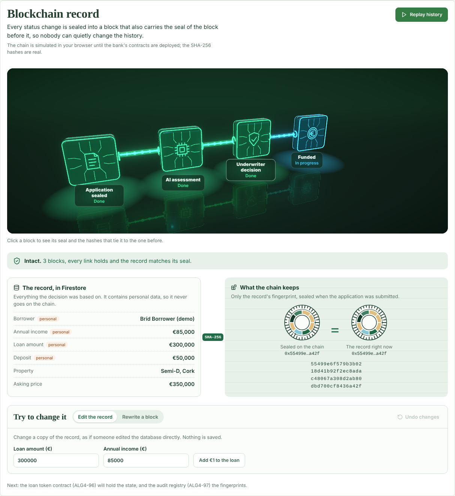
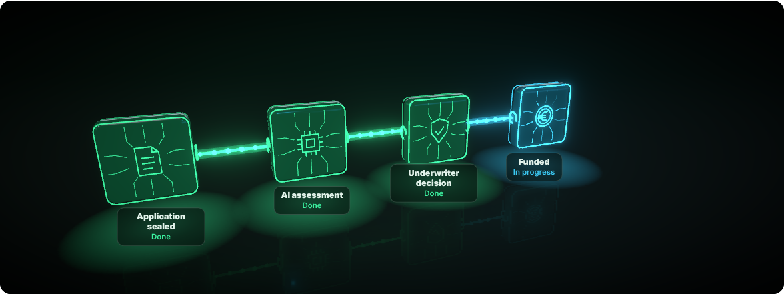
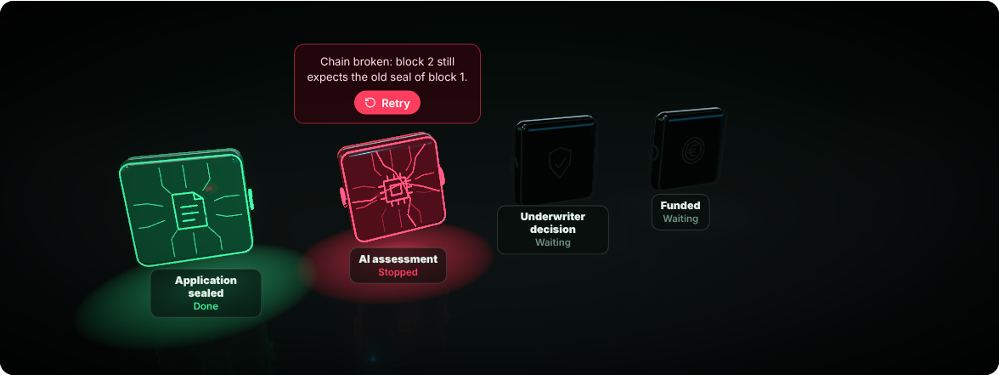
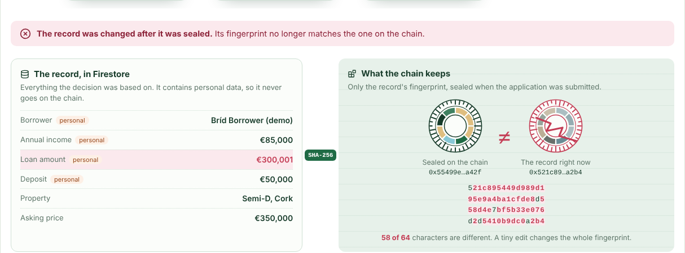
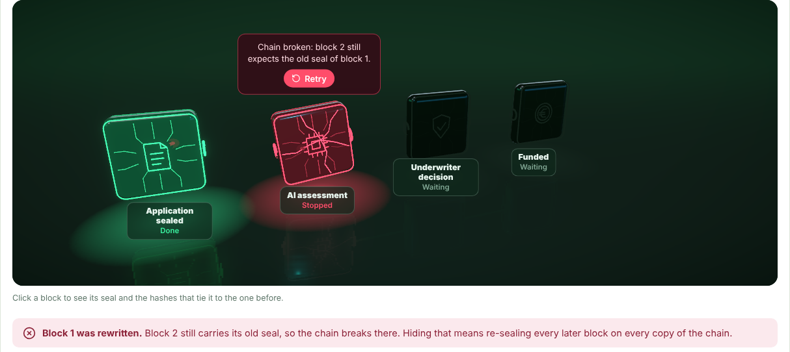

# Blockchain ledger (AL-Web)

**Jira:** ALG4-108 (custom feature) · **Author:** Pavlo · **Status:** implemented

Shows how a loan application's data is stored on a blockchain and how it moves between
states, so brokers, underwriters and auditors can see why the record cannot be quietly changed.

## Where to find it

- **Loan File:** every application has a *Blockchain record* section, built from its real
  status history in AL-Core. **Replay history** seals the blocks again one by one.
- **Blockchain** (sidebar): the story of a sample application from submission to payout. Each
  step explains what happens in the app and what the chain keeps. **Play the story** runs it
  on its own, which works well in a presentation. **What if the underwriter declines?** shows
  the chain breaking at the decision; Retry brings the approved story back.

## The 3D chain

At the top of the record, each stage of the loan (application sealed, AI assessment,
underwriter decision, funded) is a glass block in a 3D scene, tied to the next by a glowing
beam. It is built with three.js through react-three-fiber.

- **Appear:** blocks rise one after another, beams grow between them, the camera moves in.
- **Idle:** blocks float slightly, edges breathe, energy particles run along live beams.
- **In progress:** the circuit lines inside the block light up from the centre and the
  connector spins. **Done:** a flash, a small bounce, and an impulse runs to the next block.
- **Hover:** the block lifts and tilts towards the cursor and shows what the stage means.
  **Click** (or Enter on its label): the camera focuses on it and a details panel opens;
  click again or press Esc to go back.
- **Chain break:** when a stage fails (declined, withdrawn, or a block rewritten in the
  tamper test) the beam in front of it glitches and turns red, snaps in the middle with
  sparks, the block shakes, cracks and settles, and everything after it goes dark, all in
  under two seconds. A message with **Retry** appears above it; when the stage recovers the
  halves fly back together.

Performance and fallbacks: the 3D code (about 280 KB gzipped) is loaded only when the
section is about to scroll into view, rendering pauses while it is off screen, and the pixel
ratio is capped at 2. Without WebGL, and while the 3D code loads, a 2D version in CSS shows
the same stages, colours and statuses. With *reduce motion* on there is no floating, shaking,
flicker or particles. Phones get a vertical chain. Screen readers get a plain list of the
stages and their status, and the labels under the blocks are buttons (arrow keys move between
them).

## What it shows

1. **The 3D chain** above: one block per stage, as described in the section above.
2. **Sealed blocks:** one block per status change. Each block gets a **seal drawn from its
   own SHA-256 hash**: the same hash always gives the same seal, a different hash a visibly
   different one. A block keeps the fingerprint of the record (and of the decision, in the
   block that records it), the previous block's hash and its own. Threads tie each seal to
   the one before it.
3. **What the chain keeps:** the full record (names, income, amounts) stays in Firestore; the
   chain only keeps its fingerprint, shown as a seal next to the record's current seal.
4. **Try to change it:**
   - *Edit the record* (or *Add €1 to the loan*): the record's seal changes completely and
     about 60 of the 64 hex characters differ, so the change is obvious.
   - *Rewrite a block* (or *Back-date it*): the forger re-seals that block, but the next block
     still carries the old seal, so the thread snaps there.

Motion is used where it explains something: seals stamp in when a block is written, threads
draw, the token glides to the new state, hashes visibly compute when the data changes. With
*reduce motion* turned on in the system settings everything appears in its final state.

## How it works

- `web/src/ledger/ledger.js`: canonical JSON (sorted keys) → SHA-256 with the browser's Web
  Crypto API; blocks, links and verification. Covered by `npm test` (Node's built-in test
  runner, also run in CI).
- `web/src/ledger/BlockchainStages.jsx` (wrapper: lazy loading, fallback, accessibility,
  details panel), `BlockchainScene.jsx` (the 3D scene), `stages.js` (stage statuses from the
  status history, the decision and the tamper test).
- `web/src/ledger/LedgerView.jsx`: `LedgerView` (Loan File), `BlockchainExplorer` (page) and
  `Seal`, the generative seal (SVG: 36 ticks and 8 coloured segments from the hash).
- `web/src/ledger/sample.js`: the made-up application for the explorer.

The hashing is real; the chain itself is **simulated in the browser** until the contracts
exist. When ALG4-96 (loan token: the state) and ALG4-97 (audit registry: the fingerprints) are
deployed, the blocks can show real transaction hashes and the Verify step can compare against
the contract instead of the locally built chain. The record fingerprint is already computed
the way ALG4-124 describes (canonical serialisation, then SHA-256).

Web Crypto needs a secure context: it works on `https://` (Azure) and on `localhost`.
